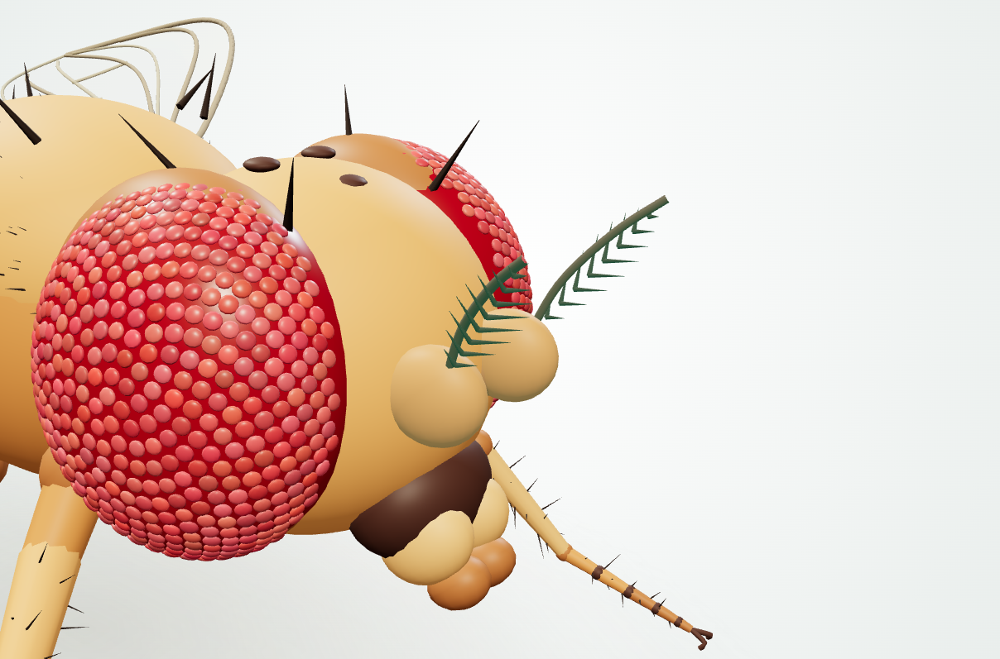

# FlyLab 3D

A virtual laboratory for *Drosophila melanogaster*. It includes 3D anatomy, dissection, imaging, simulated experiments, data analysis, and research and teaching workspaces. [Open FlyLab 3D](https://atif-devz.github.io/FlyLab-3D/) · [MouseBio_3D inspiration](https://qasim-hussain-code.github.io/MouseBio_3D/)

Developed by **Muhammad Atif**, graduate researcher at Kookmin University, Seoul, South Korea. FlyLab 3D is an independent project for science education.

## Run the app

Serve the static files in `dist` with any static web server. For example, from this directory, run `python -m http.server 8842 --directory dist` and browse to `http://localhost:8842/`. The browser needs WebGL 2. Three.js is bundled locally under its MIT license, so the explorer can run offline from a local server.

- **Dashboard** opens training benches, resumes saved sessions, and exports training plans and reports. Guided and Independent practice control the initial visual assistance.
- **Anatomy** provides structure search, layer presets, isolation, clipping, and cited structure notes for both life stages.
- **Protocols** provides four educational prototypes and a searchable inventory of 42 references, including 27 JoVE records. Prepare the bench, use tools on 3D landmarks, and complete the assessment. The library can export its structured records to CSV.
- **Living** shows the complete adult with procedural joint animation. Expand **Interactive fly** for Scientific or Fun mode, animation presets, and reduced motion. Hover or tap the adult in Living to interact. In Fun mode, double-tap for the special dance. The intact adult in Anatomy uses natural idle motion and keeps structure selection on click.
- **About** includes Muhammad Atif's researcher profile, also accessible from the Dashboard.
- **Cutaway** walks through four stages of a virtual anatomical cutaway.
- **Experiment** accepts local CSV and JSON files and maps observations to structures.
- **Compare** maps two conditions to synchronized views and a common color scale.
- **Labs** contains five expanded dissections, synthetic immunostaining/confocal images, genetics and stock tracking, conceptual molecular simulations, six synthetic recording modes, and 17 behavioral and physiological assays.
- **Research resources** searches FlyLab anatomy and protocols alongside six official metadata providers. Try the linked Ir25a records and adult sensory anatomy. The magnifier or `/` opens search from any workspace. [Open research resources](https://atif-devz.github.io/FlyLab-3D/?view=labs&station=resources&q=Ir25a)
- **Experiment builder** saves a local design record with specimen and group definitions, experimental units, bench links, references, and revision lineage. Export portable JSON and a readable report. [Open the builder](https://atif-devz.github.io/FlyLab-3D/?view=labs&station=experiment-builder)
- **Data Analysis** reads CSV, TSV, and the first visible worksheet in an Excel `.xlsx` workbook. It reports descriptive statistics, preferences, feeding corrections, spike counts/rates, right-censored survival, developmental timing, relative Cq expression, and microscopy metrics. Outputs carry provenance. The file input and example or simulator routes keep imported and synthetic data distinct.
- **Statistical inference** applies Welch’s two-sample t-test, one-way ANOVA, or Benjamini–Hochberg false discovery rate adjustment. Review input units, excluded rows, and assumptions before running a test. The workspace exports results, provenance, and observation plots. [Open statistical inference](https://atif-devz.github.io/FlyLab-3D/?view=labs&station=inference)
- **Research and Training** includes experimental planning, source search, local course handoffs, and an optional immersive anatomy viewer. The guide can rank trusted catalog entries using the browser's on-device model when one is already available. The viewer uses WebXR on compatible devices and secure origins.

Use the in-app examples for data columns and structure IDs. Imported analysis files stay in browser memory. Training, experiment drafts and theme preferences use browser-local storage when available. External research searches send only the submitted query to applicable providers. Geometry is schematic and original. The lessons await independent scientific review. [Research workbench methods](docs/RESEARCH_WORKBENCH.md) · [Roadmap](ROADMAP.md) · [Changelog](CHANGELOG.md)

## Local review rooms

From the extracted source directory, run `node serve-lab.mjs` and open the printed local address. In **Labs → Research planner**, share a named draft into a room and exchange the room code privately. Fetch the latest revision before publishing a change. Room snapshots expire after eight hours and clear on restart. The server defaults to loopback. Review across devices requires a shared trusted host with HTTPS and appropriate access controls. Standalone HTML supports offline plan JSON and assignment exchange.

## Scientific scope

The benches, signals, and experiments are teaching simulations. Molecular modules use synthetic numerical examples and high-level comparisons. Atlas-linked references are separate from the schematic geometry. The [design and validation brief](docs/Design_and_Validation.md) records scientific review, hardware testing, and deployment work still required.

## Publish and contribute

The browser app uses HTML, CSS, JavaScript and vendored Three.js. Node.js 24 builds the standalone HTML, verifies the lab workflows, and builds the public site. No application account or package installation is required. [Publishing and Search Console setup](PUBLISHING.md)

Use the About profile for the developer's affiliation. Open a repository issue for software questions, protocol proposals, and scholarly corrections. Use the private reporting route for security issues. [Contributing](CONTRIBUTING.md) · [Code of conduct](CODE_OF_CONDUCT.md) · [Security reporting](SECURITY.md)

The bundled Three.js components carry their MIT license. The project-wide license is pending the owner's selection. [Third-party notices and scientific acknowledgments](THIRD_PARTY_NOTICES.md)

## Add a protocol

Add its bibliographic record and original synopsis to `dist/protocol-catalog.js`. Add source-verified method metadata to `dist/protocol-inventory.js`. The `stage`, `category`, and `publisher` fields drive the library filters. Set `lesson` to a simulation ID when there is an interactive lesson.

Add an interactive lesson to `dist/protocol-lessons.js` and its preparation, success criteria, and concepts to `dist/training-definitions.js`. Each step names a supported action, anatomical target, camera view, and visible structures. A step can define a more specific 3D landmark and update visibility, clipping, or specimen position after the action. Give each lesson links to its primary sources. The existing stages and structure IDs are declared in `anatomy.js` and `larval-anatomy.js`.

To build a standalone HTML file from the source, run `node make-portable.mjs FlyBio_3D.html`. Open the result directly in a browser with WebGL 2. To check the package without a browser, run `node --experimental-vm-modules verify-portable.mjs FlyBio_3D.html`.
