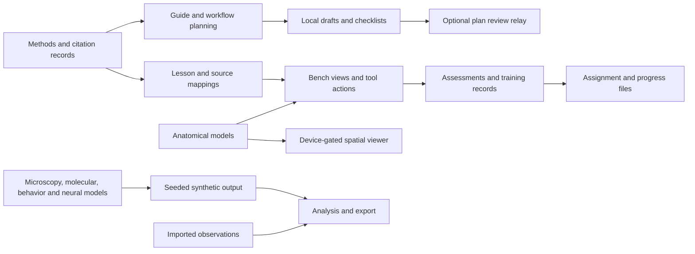

# FlyLab 3D

**Design, architecture and scientific validation plan**  
16 November 2026

## Scientific concept

FlyLab 3D is an offline *Drosophila melanogaster* teaching and research-planning workspace. Learners practice anatomical decisions, explore how a teaching model generates a signal, and inspect or export the resulting record. Researchers can draft experimental plans, link published methods, and analyze imported observations within the same application. Synthetic measurements carry their origin through the analysis workspace and its exports.

The original anatomy viewer supplies stable structure identifiers, orbit and zoom, transparency, clipping, layer isolation, and labels. Its adult female and third-instar meshes are editable schematic reconstructions. The original four CNS benches, local training progress, and anatomical observations carry forward into the expanded workspace. [Wild-type external anatomy atlas](https://pmc.ncbi.nlm.nih.gov/articles/PMC11457947/).

## Phase coverage

### 1 · Core practice

The Dashboard, Protocol Library, and Anatomy viewer connect the reference catalog to four interactive CNS benches. The library has 42 normalized published and institutional records, including 27 JoVE publications, and exports its inventory as CSV. The benches cover adult brain recovery, adult ventral nerve cord (VNC) exposure, isolation of a connected third-instar brain–VNC preparation, and larval VNC exposure. The 22 authored actions change the 3D view or specimen state. Each bench includes preparation, three concept questions, action feedback, and downloadable training records. Guided and Independent practice share the same action checks and can retain progress locally. [Adult optic lobe preparation](https://pubmed.ncbi.nlm.nih.gov/33999033/), [adult VNC whole-mount method](https://pmc.ncbi.nlm.nih.gov/articles/PMC3197069/), [larval CNS dissection](https://pubmed.ncbi.nlm.nih.gov/18704179/).

### 2 · Tissue preparation and microscopy

Expanded Dissection adds five guided benches for larval imaginal discs, larval gut, adult gut, adult ovaries, and adult testes. Learners match tools and anatomical targets, expose structures, release attachments, and move the selected preparation into a receiving well. The male abdomen has its own partial schematic. Structure selection can use either the 3D view or the keyboard controls. Completed runs export action records. [Imaginal-disc dissection](https://pmc.ncbi.nlm.nih.gov/articles/PMC4542997/), [larval gut method](https://pmc.ncbi.nlm.nih.gov/articles/PMC3991465/), [adult gut whole-mount method](https://pmc.ncbi.nlm.nih.gov/articles/PMC4430120/), [ovary preparation](https://www.jove.com/t/20101/drosophila-melanogaster-ovary-dissection-technique-for-ex-vivo-tissue), [testis preparation](https://pmc.ncbi.nlm.nih.gov/articles/PMC4089415/).

Microscopy provides conceptual immunostaining and a no-primary control. Three model specimens generate 23-plane synthetic fluorescence volumes. Learners inspect optical sections, maximum projections, and an orthogonal X–Z view. Channel selection, modeled pinhole, detector gain, and background offset affect the displayed image and clipping feedback. PNG export labels the image as synthetic. CSV and Data Analysis handoff carry per-plane intensity, area, and saturation metrics. [Confocal optical sectioning principles](https://pmc.ncbi.nlm.nih.gov/articles/PMC6961134/), [quantitative confocal microscopy guidance](https://www.nature.com/articles/s41596-020-0313-9).

### 3 · Genetics, husbandry and molecular concepts

The genetics workspace calculates inheritance for supported autosomal, sex-linked, linked, and balancer crosses. It exposes recombination and viability assumptions and reports model expectations. A local stock ledger records identifiers, genotypes, notes, and follow-up dates. Molecular teaching exercises cover idealized PCR amplification, synthetic gel interpretation, comparative Cq, and image intensity controls. A concept check distinguishes editing and regulation by their expected evidence. Operational molecular workflows and stock-specific genotype validation require their own reviewed methods. [FlyBase](https://flybase.org/), [Bloomington Drosophila Stock Center](https://bdsc.indiana.edu/), [comparative Cq method](https://pubmed.ncbi.nlm.nih.gov/11846609/).

### 4 · Neurophysiology and behavior

Seventeen behavior and physiology assays generate seeded synthetic datasets for matched groups. They include feeding choice, proboscis extension, flyPAD and CAFE, movement and social behavior, sensory preference, learning, oviposition, development, and survival. Learners vary replicate counts and examine assay-specific results such as tracks, feeding events, or censored survival curves.

Six neurobiology simulations cover labellar tip recording, antennal single-sensillum recording, electroantennography, larval neuromuscular junction responses, whole-cell current recording, and calcium imaging. The virtual electrode exercise demonstrates placement, contact effects, and threshold-based event detection. The other modes expose method-appropriate synthetic traces and summaries. The selected model and its assumptions define each output. Experimental prediction and instrument calibration require measured references and validation.

### 5 · Research, review and spatial viewing

- **Research planner.** Draft a study with a published method, groups, controls, measurements, and planned analysis. Save locally, exchange JSON drafts, or export a plain-text checklist.
- **Data Analysis.** Import CSV, TSV, or XLSX locally, or send a synthetic dataset from a simulator. Select descriptive statistics, preference, feeding, spike counts, survival, development, relative expression, or microscopy measurements. Export CSV results or an Excel workbook with provenance. Check each method's expected columns, units, and replicate assumptions.
- **Research guide.** Search the structured library and retrieve source-linked explanations. A compatible browser with an available on-device model can reorder the existing matches. Record text and citations come from the catalog in both search modes.
- **Spatial viewer.** A WebXR-capable browser on localhost or HTTPS can request immersive VR or AR for the schematic adult or larval specimen. VR supports layer switching. AR uses a surface placement test. Anatomy provides the desktop fallback.
- **Plan collaboration.** The optional Node relay starts on loopback. Create or update a room only when explicitly sharing a plan. The room code authorizes viewing and updates. Revision checks detect concurrent updates. Rooms are held in memory and expire after eight hours. Offline handoff uses the plan file.
- **Course workspace.** Compose an assignment from dissection lessons and exchange it as a JSON file. Learners can export assignment progress, and instructors can collect matching progress files and export a combined CSV. This workflow uses files and local state. Managed course accounts and institutional roles require a separate deployment.

## Module architecture

Authored lessons, experimental models, and source records have separate responsibilities. The core lesson player resolves tool and structure IDs, evaluates the action, then updates the display. An added lesson can reuse existing anatomy and tools through declarative steps. The tissue benches reuse the adult and larval models and extend the specimen where needed. Analysis consumes named fields and origin metadata from generating modules or imports. Browser storage covers plans, stocks, preferences, and training progress where available. The optional relay handles shared plan snapshots and revision checks separately from local rendering and analysis.

## Data and provenance

- **Source and protocol.** Preserve citation, DOI or official landing page, access status, verification date, species, stage, tissue, instruments, prerequisites, overview, and optional lesson mapping. Use verified controlled vocabulary matches. [FlyBase controlled vocabularies](https://wiki.flybase.org/wiki/FlyBase%3AControlled_vocabularies_used_by_FlyBase).
- **Lesson and review.** Track the exact version, specimen, tools, landmarks, transitions, expected endpoints, and assessment. A review records the reviewer, date, scope, evidence, outcome, and retest date.
- **Training run and dataset.** A training record describes learner actions and answers. A dataset retains source, condition, sample or replicate identity, units, and transformations. Simulator exports identify their origin as synthetic. Reports for imported observations identify the imported source.
- **Plan and collaboration.** Keep the study design, source ID, control design, planned measurement, and analysis together. Live review uses a code and an expected revision. Role-based workflow, durable storage, and identity management require a deployment design.

The library reproduces citation metadata and original summaries. Full materials remain with their publishers. Any future embedded video, figure, or atlas mesh needs asset-specific permission and attribution. Record release, license, preprocessing, and source coordinates with each distributed asset. [JoVE author policies](https://www.jove.com/authors/publication), [Virtual Fly Brain data documentation](https://virtualflybrain.org/docs/data/).

## Review and release gates

Use separate evidence and simulation labels. A **published procedure** identifies the method supported by the cited source. An **educational prototype** has functioning controls and generated outputs. An **expert-reviewed simulation** requires independent review of the exact lesson, specimen, model assumptions, and expected endpoint. Record evidence for each claim before changing these labels.

Verify tool behavior, target selection, keyboard access, transitions, exports, and data handoff in a desktop browser. Check a complete run and recovery from an incorrect action for each lesson. Review the scientific endpoints separately. Adult brain transfer should preserve both optic lobes. The adult in-place VNC exercise should preserve the cervical connection. Third-instar brain–VNC transfer should keep the two lobes and cord together. Expanded dissection and optical controls require expert assessment of anatomical accuracy, tissue boundaries, and interpretability.

For simulations, compare seeds, units, condition labels, and outcomes against tests with known answers. Keep assumptions visible when those outcomes are exported. Assess browser-specific AI ranking, XR session behavior, and relay access on their actual deployment surfaces. Browser model availability, headset and AR placement behavior, independent scientific review, and any institutional approval are separate from code-level checks.

## Next validation and development work

FlyLab has working educational features across all five phases. High-fidelity anatomy, measured neural circuits, realistic tissue mechanics, and instrument-calibrated predictions remain development goals. Embryos, pupae, and other larval instars each require their own reference assets. For atlas overlays, record sex, developmental stage, acquisition method, registration, laterality, scale, and coordinate frame before enabling precise labels. The adult female FlyWire reconstruction and first-instar connectome describe different preparations. Third-instar lessons require third-instar evidence for claims about measured geometry or connectivity. [FlyWire adult whole-brain reconstruction](https://www.nature.com/articles/s41586-024-07558-y), [first-instar larval connectome](https://pmc.ncbi.nlm.nih.gov/articles/PMC7614541/).

The standalone app and editable source archive retain the existing `FlyBio_3D` filenames in the outputs folder. Open the HTML for local use. The optional relay and WebXR setup are described in the source archive.
